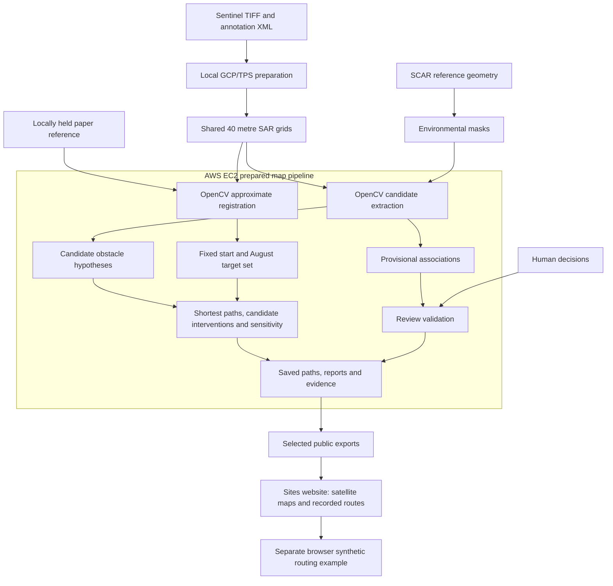

# How Iceberg Watch fits together

Updated 23 October 2026.

The project has three connected parts: preparation turns satellite inputs into a common geographic grid, the Python pipeline computes candidates and conditional access scenarios, and the public website presents selected saved results. AWS runs the prepared map analysis, while Sites hosts the browser presentation. These are separate responsibilities, so opening the website does not start an AWS processing job.

## Preparing a consistent comparison

`prepare_maps.py` reads the satellite measurements and their annotation information, then creates the shared 40 metre grid. This experimental transformation makes date comparisons possible but does not provide terrain correction. SCAR reference surfaces supply environmental exclusions, while the locally held paper reference supplies an approximate August start and boundary through a separate registration process.

## Computing and checking the results

The Python batch extracts candidates, applies environmental filtering and proposes temporal associations before constructing obstacle hypotheses. Routing compares those hypotheses under fixed reference assumptions at two grid spacings. Individual candidate interventions separate detections from their tested route effects. Corridor and boundary perturbation experiments test how much the chosen settings affect the answer, while validation checks distances, traversability and the provenance of review decisions.

Human review is an input to the evidence record, rather than an invisible correction of the automatic detector. Review decisions do not retrain the detector or silently rewrite its masks. The separate visual mark audit describes uncertain observations without converting them into verified accuracy scores.

## Serving the public demonstration

`build_exports.py` reads saved research artifacts, checks their geometry and source relationship, and exports selected satellite layers, route coordinates, numeric results and readable documentation. It also checks that the exported coordinate lengths agree with the saved solver distances. The website draws those coordinates over the matching SAR image and lets visitors choose a date, grid, barrier policy and optional corridor.

The original paper image and digitised target boundary are not copied into the website. The displayed start and endpoint belong to the calculated path and retain the approximate reference dependency described in the report. Candidate overlays show proposal pixels, which are not an exact rendering of the coarser aggregated obstacle grid.

The synthetic routing panel is deliberately separate. It demonstrates shortest path behaviour on an editable grid and recomputes in the browser, whereas the Antarctic panel selects recorded results. The site contains no AWS credentials, raw satellite archive or automatic ingestion scheduler. The website is public and the source is distributed as an archive, while the underlying local research inputs remain separately managed.
